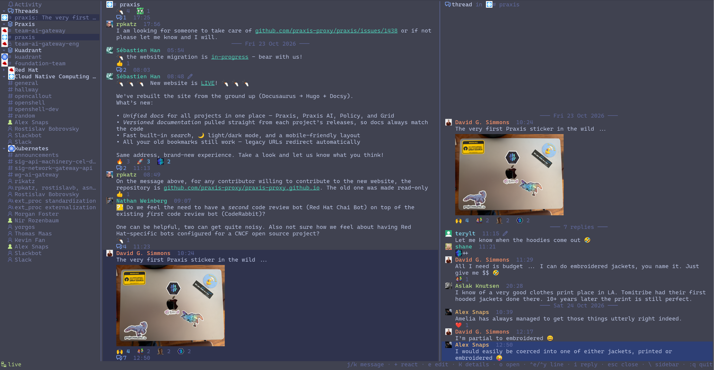

# slackers

A terminal Slack client that groups Conversations by subject across Workspaces, rather than one Workspace at a time.



Channels from different Workspaces that belong to the same subject (a project, a team) go together in a **Virtual
Workspace**, which lights up when any of them has something unread. DMs stay with their Workspace. The words used
here, and in the code, are defined in [CONTEXT.md](CONTEXT.md).

## What it does

- **Every Workspace at once**: the sidebar lists your Virtual Workspaces, then each Workspace's other Channels and
  DMs, with unread and Mention badges; **Activity** merges every Workspace's Mentions, Reactions, Thread Replies and
  DMs, newest first; your Followed Threads with unread Replies have a section of their own.
- **Picks up where you left off**: a Conversation or Followed Thread opens on its first unread Message, under a "new"
  rule, and is marked read once you reach its newest.
- **Reading**: Threads open beside their Conversation; images, animated GIFs, Custom Emoji and avatars show inline;
  who's typing shows on the pane's title, and whether a DM's other person is active on its sidebar icon.
- **Writing**: @-mentions, `:emoji:` and slash commands complete as you type; reactions, editing your Messages,
  marking Messages unread, and pressing apps' buttons (such as Giphy's).
- **Desktop notifications** for DMs, Mentions and Replies in your Followed Threads, while the window doesn't have
  focus.

## Requirements

- [Ghostty](https://ghostty.org). Pictures use the kitty graphics protocol's Unicode placeholders, which slackers is
  built and tested against in Ghostty only.
- A [Nerd Font](https://www.nerdfonts.com), for the icons.
- Linux, with `secret-tool` from libsecret and a Secret Service keyring (GNOME Keyring, KeePassXC, …), or macOS.
- Rust 1.88 or newer, to build it.

## Install

```sh
cargo install --path crates/slackers
```

or `cargo build --release` and run `target/release/slackers`.

## Sign in

slackers signs in to each Workspace as Slack's web client does, with your browser session's credentials: a token per
Workspace and the session's `d` cookie, shared by every Workspace (see
[ADR 0001](docs/adr/0001-slack-session-token-auth.md) for why). They grant full access to your account: treat them as
passwords. slackers reads them from your system keyring, never from a file.

### Find the token and the cookies

1. In your browser, sign in to every Workspace you want, then open <https://app.slack.com>.
2. Open the developer tools.
3. **Tokens** (`xoxc-…`, one per Workspace): in the console, run
   `Object.values(JSON.parse(localStorage.localConfig_v2).teams).map(t => [t.name, t.token])`.
4. **Cookies**: under the site's storage, in the cookies for `.slack.com`, copy the value of `d` (`xoxd-…`) and, if
   there is one, `d-s`.

They all belong to the same browser session. Logging out, or signing in to another Workspace in that browser, replaces
the `d` cookie: when slackers says it's signed out, store a fresh one.

### Store them

Each token is stored under the label you give its Workspace in the config (below), such as `cncf`. Each command
prompts for the secret, which keeps it out of your shell's history.

**Linux** (Secret Service):

```sh
secret-tool store --label='slackers d cookie'   service slackers key d-cookie
secret-tool store --label='slackers d-s cookie' service slackers key d-s-cookie   # only if your browser has one
secret-tool store --label='slackers cncf token' service slackers key token workspace cncf
```

**macOS** (login Keychain):

```sh
security add-generic-password -U -s slackers -a d-cookie -w
security add-generic-password -U -s slackers -a d-s-cookie -w   # only if your browser has one
security add-generic-password -U -s slackers -a token:cncf -w
```

Repeat the token line for every Workspace, with its label.

## Configure

`~/.config/slackers/config.toml` (or under `$XDG_CONFIG_HOME`):

```toml
# Workspaces to sign in to, by their label in the keyring, in sidebar order.
workspaces = ["redhat", "cncf"]

[[virtual_workspace]]
name = "Kuadrant"
channels = ["redhat#kuadrant", "cncf#kuadrant-dev"]
```

`:vw add NAME` puts the open Channel in the Virtual Workspace called NAME, creating it if need be, and `:vw rm NAME`
takes it out; slackers rewrites the file, keeping its comments and layout.

Logs go to `~/.local/state/slackers/slackers.log` (or under `$XDG_STATE_HOME`).

`slackers --debug` helps when signing in keeps failing: a Workspace that couldn't be signed in to shows, under the
reason, the token and cookies that were tried, so you can tell a stale cookie from a mistyped one. It also logs the
`d` cookie (and `d-s`, when there is one), and logs down to `debug`. Those grant full access to your Slack account:
only run it where nobody else can see the screen, and mind what you share of the log afterwards.

## Keys

They work as in vim. The status line shows the ones that apply where you are.

| Where | Keys |
|---|---|
| Anywhere | `\` sidebar · `/` search the sidebar · `:q` quit |
| Sidebar | `j`/`k` move · `g`/`G` first, last · `Enter` open · `za` `zo` `zc` fold a section · `zM` `zR` fold or unfold all |
| Messages | `j`/`k` move · `g`/`G` oldest, newest · `Ctrl-d`/`Ctrl-u` half a page · `Ctrl-e`/`Ctrl-y` a line · `Enter` open its Thread · `i` write · `+` react · `e` edit yours · `U` mark unread from here · `K` details · `o` open its link · `Esc` back |
| Writing | `Enter` send · `Alt-Enter` new line · `@`, `:` and `/` complete people, emoji and commands · `↑` edit your last · `Ctrl-x Ctrl-e` `$EDITOR` · `Esc` stop |
| Details (`K`) | `j`/`k` choose · `Enter` or `1`-`9` press or open · `y` copy · `Esc` close |

Drafts are written in Markdown: `**bold**`, `_italic_`, `~~strike~~`, `` `code` ``, code blocks, `> quotes`,
headings and `[links](https://…)` post as Slack shows them, and editing a Message brings it back in Markdown. `*bold*`
stays bold, as in Slack. Headings post as bold lines, and code blocks lose their language: Slack has neither.

A Draft starting with `/` runs that slash command, as in Slack: start it with a space to post it as text. When a
command posts for you elsewhere, as `/dm @someone hi` does, slackers follows it there.

## License

[GPL-3.0-or-later](LICENSE).
